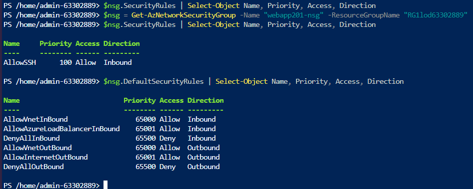
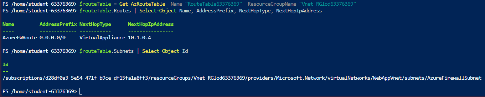
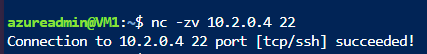
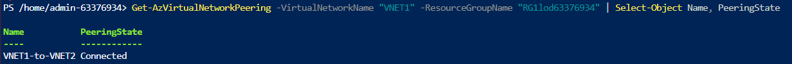
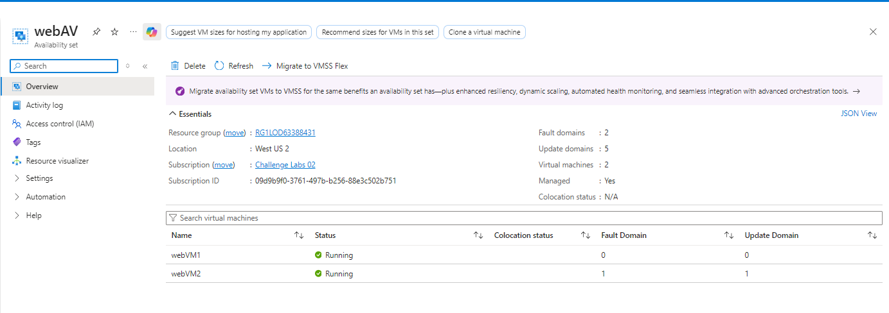
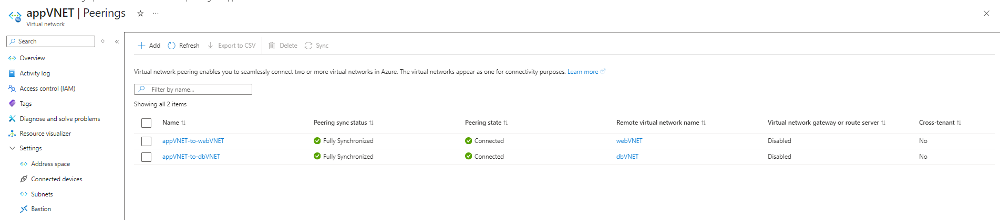
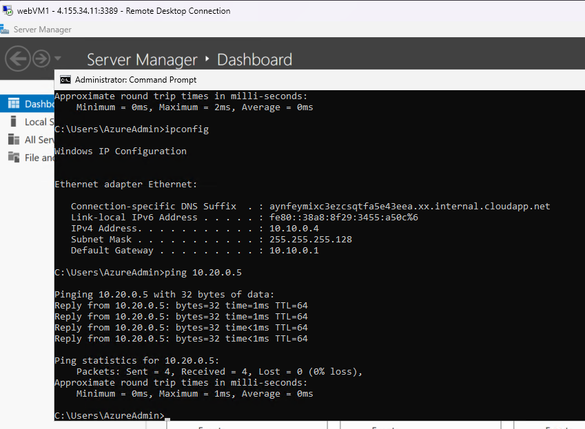

# cloud-routing-and-isolation
## Project Focus
This repository documents the practical configuration, testing, and troubleshooting of core cloud networking components within Microsoft Azure. The focus of this sprint was to implement practical traffic segmentation, use custom User-Defined Routes (UDRs) to control traffic flow, and set up a high-availability multi-tier network structure.

## Lab Module Breakdowns
### Lab 1: Network Security Group (NSG) Configuration & Auditing
**Objective:** Apply network security rules at the subnet and interface level to restrict inbound traffic and verify active policies using automation.  

**Technical Implementation:** Tested how custom rules interact with Azure's default security rules. Using Azure PowerShell, I audited the active inbound policies protecting the subnet:  

```powershell
# Active Security Rules Verification
$nsg.SecurityRules | Select-Object Name, Priority, Access, Direction

Name      Priority   Access   Direction
----      --------   ------   ---------
AllowSSH  100        Allow    Inbound
```
To see what underlying traffic baselines were overridden, I also dumped the infrastructure's default platform rules:  


```powershell
$nsg.DefaultSecurityRules | Select-Object Name, Priority, Access, Direction

Name                             Priority Access  Direction
----                             -------- ------  ---------
AllowVnetInBound                 65000    Allow   Inbound
AllowAzureLoadBalancerInBound    65001    Allow   Inbound
DenyAllInBound                   65500    Deny    Inbound
AllowVnetOutBound                65000    Allow   Outbound
AllowInternetOutBound            65001    Allow   Outbound
DenyAllOutBound                  65500    Deny    Outbound
```  


**Key Takeaway:** Confirmed that the custom AllowSSH entry which uses a smaller priority number than the default Azure rules (such as DenyAllInbound at priority 65500) gets prioritised, whilst leaving a large range of numbers to expand the ruleset when needed.  

### Lab 2: Traffic Routing via User-Defined Routes (UDR)
**Objective:** Redirect outbound internet traffic away from default paths and force it through a central security firewall instance instead.  

**Technical Implementation:** Created a custom routing table and applied a 0.0.0.0/0 (all traffic) rule directly to the subnet to change the default next-hop destination.   

```powershell
# Validating Core Routing Context Override
$routeTable.Routes | Select-Object Name, AddressPrefix, NextHopType, NextHopIpAddress

Name           AddressPrefix   NextHopType        NextHopIpAddress
----           -------------   -----------        ----------------
AzureFWRoute   0.0.0.0/0       VirtualAppliance   10.1.0.4
```  

  

**Key Takeaway:** By setting the NextHopType to VirtualAppliance and pointing it to 10.1.0.4, the default direct connection to the internet was neutralized. This forces all outbound network traffic to safely pass through the central Azure Firewall first.  
### Lab 3: Interconnecting Networks via VNet Peering
**Objective:** Connect separate virtual networks (VNET1 and VNET2) directly across the internal Azure cloud backbone without sending traffic over the public internet.  

**Technical Implementation:** Established bidirectional Virtual Network Peering links and validated both the network control plane and live data path.  

**Notable Troubleshooting:** Initial connectivity checks using standard ping commands showed 100% packet loss. I identified that the Linux operating system on the target VM drops ICMP Echo requests by default. To verify actual network transit, I bypassed this OS block by using a Netcat (nc) port probe to test the open SSH management port instead:  

```bash
# Bypassing ICMP drop parameters via low-level TCP port scan
nc -zv 10.2.0.4 22
Connection to 10.2.0.4 22 port [tcp/ssh] succeeded!
```  


```PowerShell
# Verifying VNet Peering Connection Status
Get-AzVirtualNetworkPeering -VirtualNetworkName "VNET1" | Select-Object Name, PeeringState

Name             PeeringState
----             ------------
VNET1-to-VNET2   Connected
```  



### Lab 4: Multi-Tier Architecture & High Availability
**Objective:** Build a three-tier network environment (webVNET, appVNET, dbVNET) that physically isolates the database layer while protecting virtual machines from hardware outages.  

**Technical Implementation:** Built a hub-and-spoke peering topology where the web and database layers cannot talk directly to one another. To keep the frontend operational during data center hardware updates or unexpected rack power failures, VMs were split across distinct Fault Domains and Update Domains using Availability Sets:  
```Plaintext
Virtual Machine   Status    Fault Domain   Update Domain
---------------   ------    ------------   -------------
webVM1            Running   0              0
webVM2            Running   1              1
```  

  

**Spoke topology with appVNET-to-webVNET and appVNET-to-dbVNET connections**  

  

**(10.10.0.4) to appVNET tier, confirming the routing configuration**  

  

**Key Takeaway:** If a hardware fault corrupts data rack 0, webVM2 remains fully active on rack 1, ensuring the application framework maintains zero-downtime service metrics.