# storage-security-and-governance
## Project Focus
This repository documents the practical configuration, testing, and troubleshooting of Azure storage security, DNS management, and identity governance. The focus of this sprint was to implement secure blob storage access controls using Shared Access Signatures (SAS), configure custom DNS zones for internal name resolution, enforce compliance policies across resource deployments, and establish least-privilege access through custom RBAC roles and managed identities.  


## Lab Module Breakdowns
### Lab 1: Custom Azure DNS Zone & Name Resolution
**Objective:** Map a custom domain name to internal cloud infrastructure so traffic routes correctly through private name resolution without relying on manual IP addresses.  

**Technical Implementation:** Created a public DNS zone and added an A record mapped to target IP 10.10.10.10 with a 3600-second TTL.  

```powershell
# Provisioning custom DNS zone and mapping the authoritative A record
New-AzDNSZone -Name "TestDomain63442995.com" -ResourceGroupName "TestDomainlod63442995"

New-AzDNSRecordSet -Name www -ZoneName "TestDomain63442995.com" `
    -ResourceGroupName "TestDomainlod63442995" -Ttl 3600 -RecordType A `
    -DnsRecords (New-AzDnsRecordConfig -IPv4Address 10.10.10.10)
```  
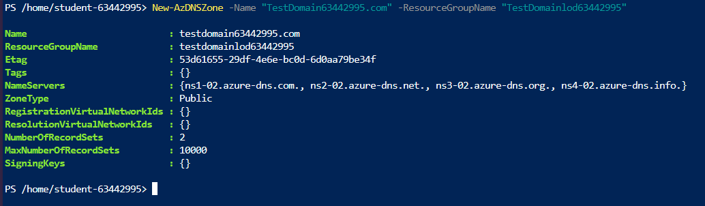  
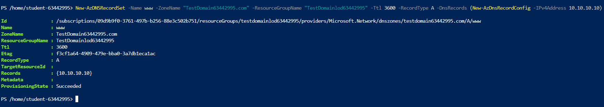  
**To verify the custom domain was successfully hosted on the network control plane, I checked the record set configuration inside the Azure Portal:**  

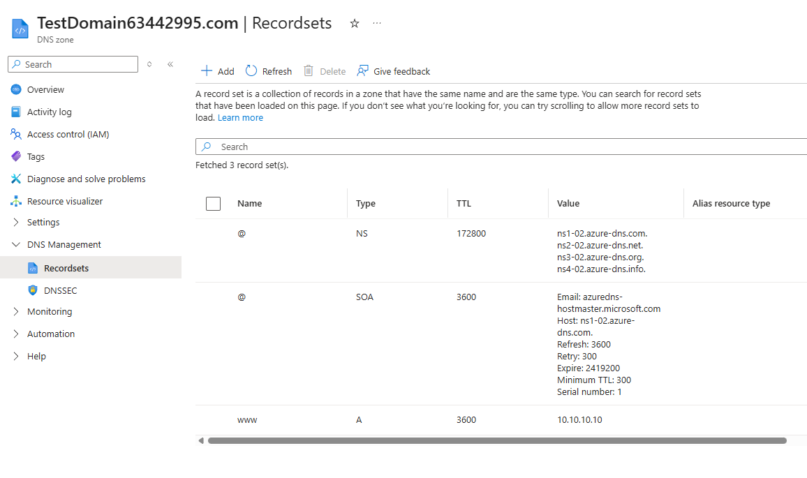  

**To ensure external clients can resolve the hostname, I tested the DNS lookup path directly against the assigned Azure Name Server using nslookup:**  

```powershell
# Testing authoritative DNS resolution against Azure's public name server
nslookup www.TestDomain63442995.com ns1-02.azure-dns.com
Server:  ns1-02.azure-dns.com
Address: 13.107.236.2

Name:    www.TestDomain63442995.com
Address: 10.10.10.10
```  

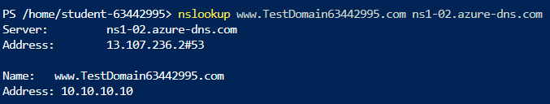  

**Key Takeaway:** By setting up the A Record and pointing directly to Azure's public name servers, any request sent to [www.TestDomain63442995.com](https://www.TestDomain63442995.com) cleanly resolves to 10.10.10.10. Automating this through PowerShell allows rapid domain configuration without clicking around the portal.  


### Lab 2: Private Blob Storage & SAS Token Authorization
**Objective:** Secure an Azure Blob Storage container by disabling public read access and providing temporary, granular access to private files using Shared Access Signatures (SAS).  


**Technical Implementation:** Configured the private blob container to block anonymous incoming requests. To grant controlled external access without exposing master storage account keys, I generated a time-bound SAS token scoped specifically to read operations.  

**To verify that unauthenticated public requests were actively blocked at the storage firewall layer, I attempted a direct HTTP request against the blob URL using curl:**  


```bash
# Validating public access block on private container
curl -I https://sa63442995.blob.core.windows.net/private/Screenshot%202026-07-15%20212029.png
HTTP/1.1 409 Public access is not permitted on this storage account.
```  

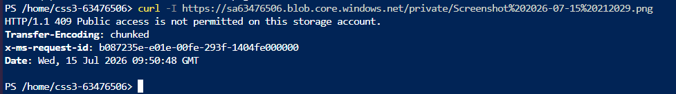  

**Next, I audited the storage account network rules via PowerShell to confirm default access parameters and bypass settings:**  

```powershell
# Auditing Storage Account Network Rule Sets
Get-AzStorageAccountNetworkRuleSet -ResourceGroupName "CSSClod63476506" -Name "sa63476506"

Bypass        : AzureServices
DefaultAction : Allow
```  

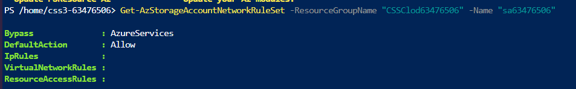  

**To verify access behaviors using application credentials, I passed the storage account key and generated SAS token into a test web application. Direct raw URLs failed with a 409 error as expected, while appended SAS tokens successfully authorized file downloads:**  

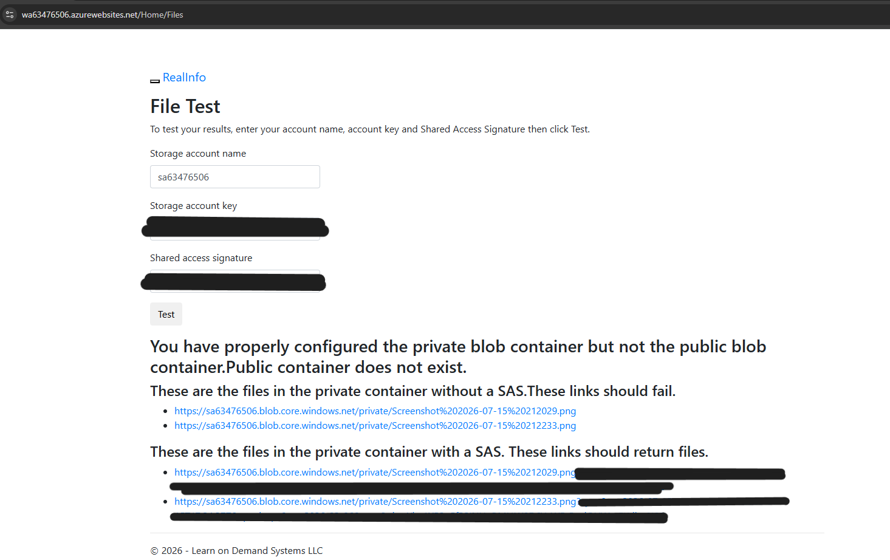  

**Key Takeaway:** Enforcing private access on Blob containers prevents accidental data exposure. Using Shared Access Signatures allows third-party applications or users to access specific files securely for a limited window without handing out full administrative keys.  
 
### Lab 3: Configure Public Blob Storage & Anonymous Access  
**Objective:** Enable public anonymous read access on a dedicated storage container to serve static assets directly over the internet without requiring credentials or SAS tokens.  

**Technical Implementation:** Created a public container within the storage account and explicitly changed its anonymous access level to Blob (anonymous read access for blobs only). Uploaded test media assets directly into the container using the Azure Portal interface.  

**To verify the access level configuration on the control plane, I checked the container overview list inside the Azure Portal:**

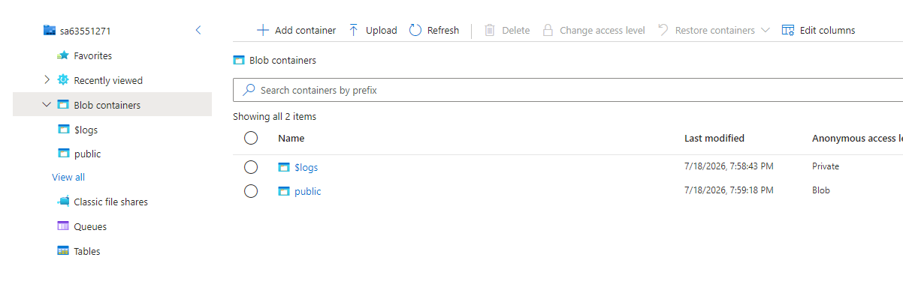  

**Next, I uploaded the target media assets directly into the public container:**  

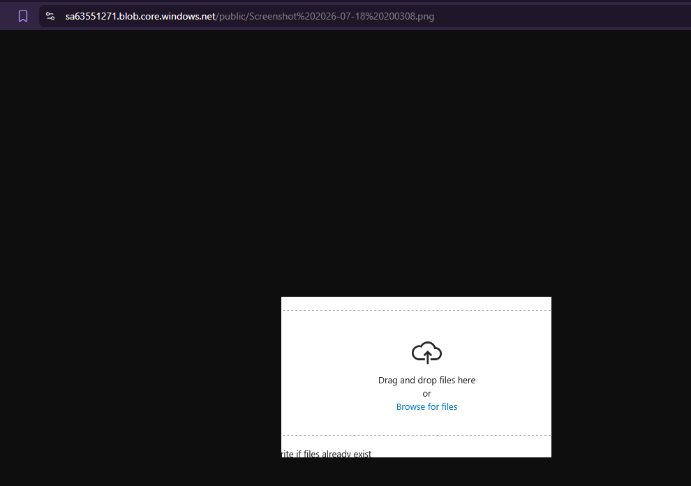  

**To test raw public reachability, I initiated an HTTP header check against the blob endpoint using curl from the Cloud Shell:**  


```bash
# Validating anonymous HTTP 200 OK access on public blob asset
curl -I https://sa63551271.blob.core.windows.net/public/Screenshot%202026-07-18%2020200042.png

HTTP/1.1 200 OK
Content-Length: 672
Content-Type: image/png
Server: Windows-Azure-Blob/1.0 Microsoft-HTTPAPI/2.0
```  

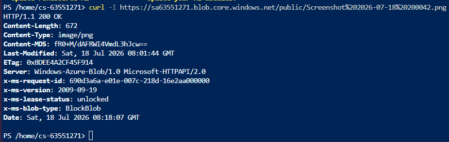  

**For further verification, I passed the storage credentials into the application validation interface. The web app successfully verified that public assets resolve cleanly over direct HTTPS links without needing query tokens:**  

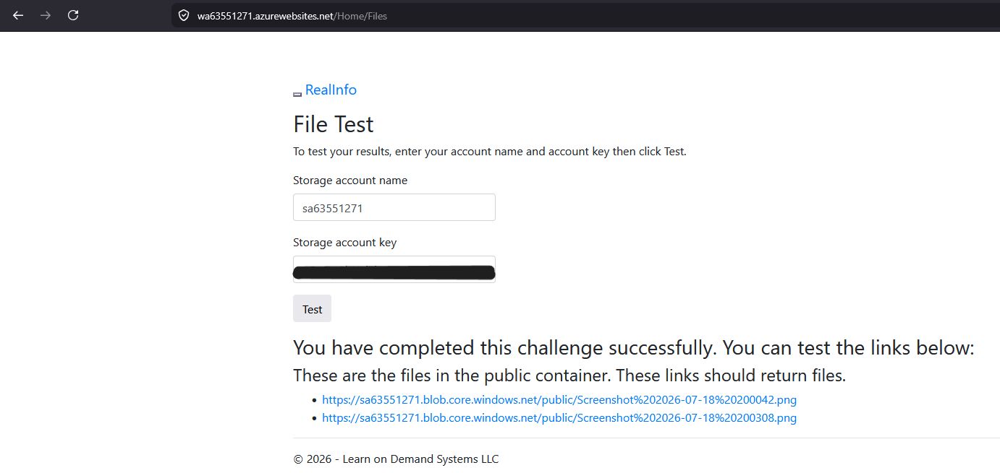  

**Key Takeaway:** Setting the access level to Blob allows direct anonymous HTTP downloads for individual files while keeping container-level directory listing restricted. This is ideal for serving public website graphics or downloadable application assets.  

### Lab 4: Azure Policy, Custom RBAC & Managed Identities  

**Objective:** Enforce compliance constraints across resource deployments, create least-privilege RBAC roles, and assign managed identities to virtual machines for secure, credential-free authentication.  


**Technical Implementation:** Assigned compliance boundaries at the resource group level, crafted custom authorization definitions to avoid over-privileged default roles, and linked a User-Assigned Managed Identity directly to a Virtual Machine.  

**First, I enforced geographical compliance by scoping an "Allowed locations" policy assignment directly to resource group RG1:**

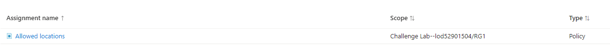  

**To maintain strict least-privilege principles without giving out unnecessary administrative rights, I built a custom RBAC role specifically scoped to storage account management while explicitly excluding support actions:**  
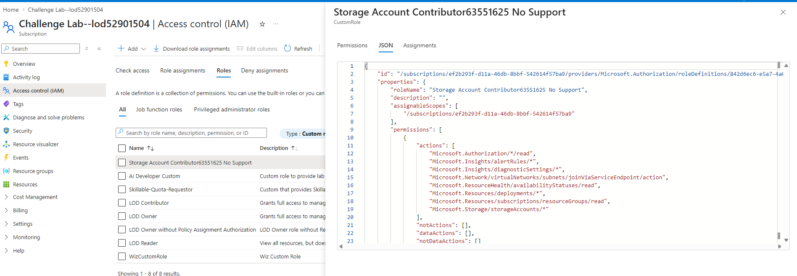  

**Next, I assigned the Network Contributor role to TestUser-63551625 with an explicit time-bound eligibility policy to limit permanent privilege exposure:** 

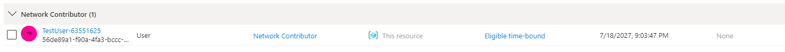  

**To verify identity delegation without storing secrets or passwords in application code, I attached a standalone user-assigned managed identity (mymanagedid63551625) to MyVM:** 

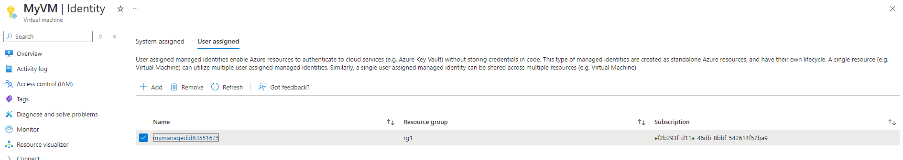  

**Key Takeaway:** Combining Azure Policy and Custom RBAC establishes tight guardrails around resource provisioning and user capabilities. Attaching Managed Identities directly to VMs eliminates hardcoded API keys and credentials, allowing workloads to authenticate securely to other Azure resources out of the box.