# deployment-balancing-and-protection
## Project Focus
This repository documents the practical configuration, automated provisioning, load balancing, traffic routing, and application backup strategies for Azure IaaS workloads. The focus of this sprint was to implement end-to-end infrastructure lifecycle operations, spanning high-availability compute scale sets behind Azure Load Balancers, Layer 7 web traffic management via Application Gateways, zero-touch automated VM provisioning using Custom Script Extensions, and enterprise disaster recovery for database workloads using Recovery Services Vaults.

## Lab Module Breakdowns
### Lab 1: Deploy, Balance and Configure a Load-Balanced Virtual Machine Scale Set
**Objective:** Capture a customized Linux virtual machine to create a reusable managed image, deploy a highly available Virtual Machine Scale Set (VMSS) from the image, and integrate a Load Balancer to distribute incoming traffic.  

**Technical Implementation:** Deprovisioned and generalized a source virtual machine, built a custom Azure Managed Image, and deployed a Virtual Machine Scale Set backed by a Standard SKU Load Balancer.  


**To prepare the template VM for generalization without residual user accounts or machine-specific keys, I deprovisioned the guest OS and captured the managed image via Cloud Shell:**

```bash
# Deprovisioning Linux guest OS, deallocating, generalizing VM1, and creating managed image
azureuser@VM1:~$ sudo waagent -deprovision
azureuser@VM1:~$ exit

user1-63615299 [ ~ ]$ az vm deallocate --resource-group rg1lod63615299 --name VM1
user1-63615299 [ ~ ]$ az vm generalize --resource-group rg1lod63615299 --name VM1
user1-63615299 [ ~ ]$ az image create -g rg1lod63615299 -n VM-image --source VM1
```  

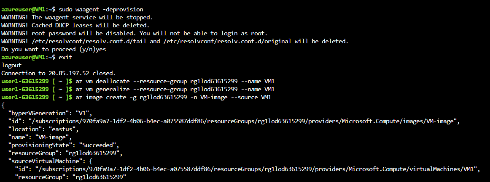  

**To confirm the scale set instances were actively inheriting our custom pre-configured environment, I verified the storage profile image reference on instance 0:**  

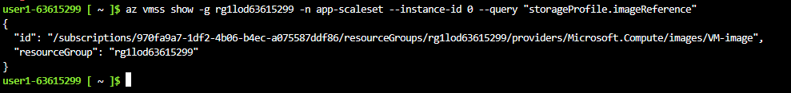  

**Next, I listed the running VMSS nodes using Azure CLI to audit provisioning health across all scale-out instances:**  
**I will also note that seeing LatestModelApplied is True for all nodes below means every instance is running the same standardized configuration without diverging.**    
```bash
# Auditing VMSS Instance Status and Provisioning States via Azure CLI
az vmss list-instances -g rg1lod63615299 -n app-scaleset -o table

InstanceId    LatestModelApplied    Location    Name              ProvisioningState    ResilientVMDeletionStatus    ResourceGroup     TimeCreated
------------  --------------------  ----------  ----------------  -------------------  ---------------------------  ----------------  ---------------------------------
0             True                  eastus      app-scaleset_0    Succeeded            Disabled                     rg1lod63615299    2026-07-21T09:07:34.076208+00:00
1             True                  eastus      app-scaleset_1    Succeeded            Disabled                     rg1lod63615299    2026-07-21T09:07:34.076208+00:00
2             True                  eastus      app-scaleset_2    Succeeded
```  

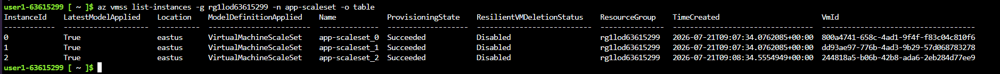  


**I cross-verified the instance statuses and overall health states directly within the Azure Portal UI:**  
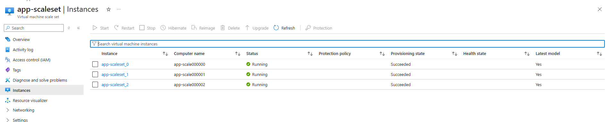  


**Finally, I inspected the Azure Load Balancer configuration to ensure all three VMSS network interface targets (vnet-eastus-nic01) were attached inside the backend pool**  
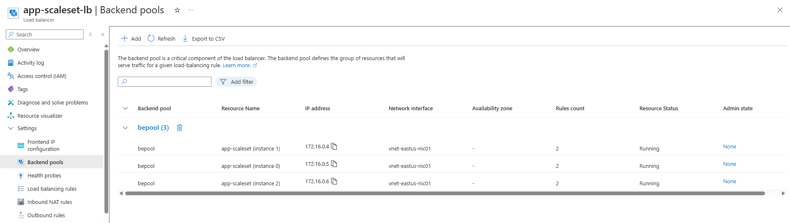  

**Key Takeaway:** Deprovisioning a VM with waagent -deprovision strips sensitive SSH keys and network leases, allowing you to create clean, reusable custom images. Deploying Virtual Machine Scale Sets from a custom clean image ensures every autoscaled node launches with standardized software configurations while remaining dynamically load-balanced.


### Lab 2: Route and Protect Secure Web Applications with Azure Application Gateway and WAF
**Objective:** Deploy and configure an Azure Application Gateway (WAF v2 Tier) to deliver Layer 7 load balancing and URL-based routing, backed by an Application Gateway Web Application Firewall (WAF) policy to protect backend web workloads against common OWASP vulnerabilities.

**Technical Implementation:** Deployed an Application Gateway in resource group `RG1lod63646045` across Availability Zones 1, 2, and 3. Integrated a WAF v2 SKU frontend bound to public IP `4.157.5.95`, configured backend target pools, and applied a custom Web Application Firewall policy operating in Prevention mode.  

**First, I provisioned the Application Gateway on the dedicated subnet and verified its zone-redundant WAF V2 deployment state:**  

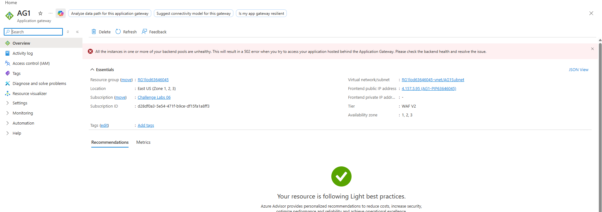  

**Next, I mapped the compute instances into the backend pool to handle inbound Layer 7 web traffic:**  

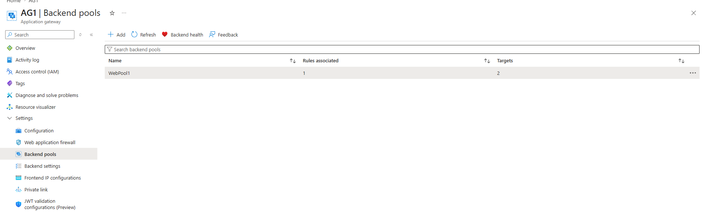  

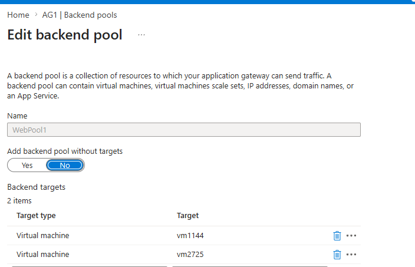  

**To filter out malicious web traffic before it reaches the application, I enabled the WAF policy in Prevention mode. This actively blocks attacks rather than just logging them**  

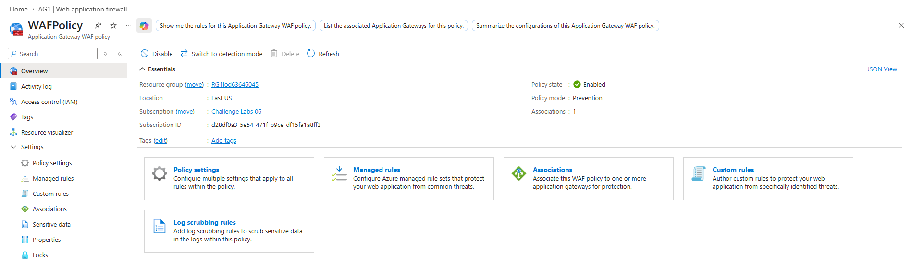  

**The WAF runs with OWASP 3.2 managed rules enforcing SQL injection, XSS, and command injection protections:**  

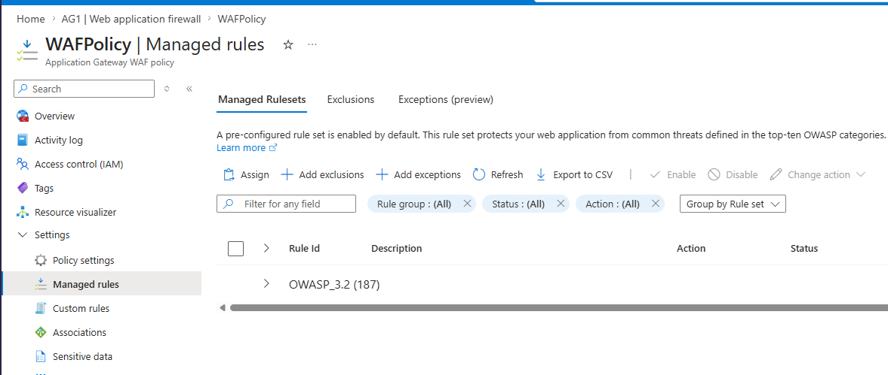  

**Finally, to demonstrate the ability to handle specific application requirements, I executed a granular rule tuning override by disabling rule ID 942100 (SQL Injection Attack Detected via libinjection):**  

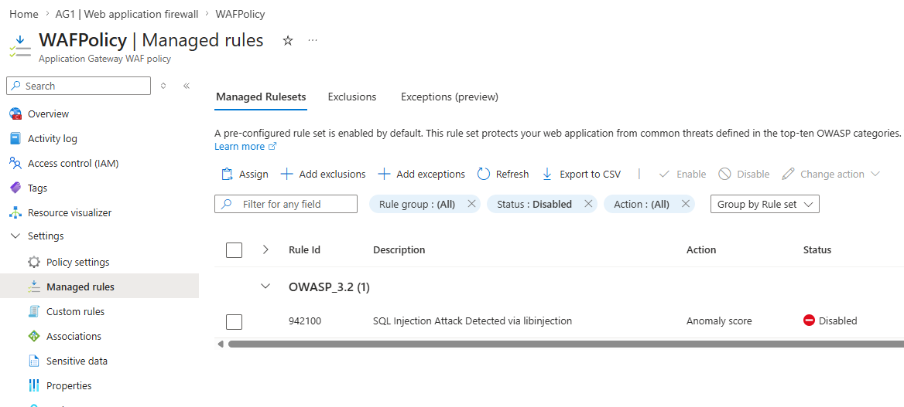  

**Key Takeaway:** Unlike Standard Layer 4 Load Balancers, Azure Application Gateway operates at Layer 7, providing HTTP/HTTPS routing, SSL termination, and WAF protection. Fine-tuning WAF rules (such as disabling false-positive triggers like rule 942100) allows organizations to maintain strict application security while preventing accidental service disruption to legitimate application traffic.  

### Lab 3: Automate Workloads by Deploying Web Services via Custom Script Extension  

**Objective:** Automate the configuration and post-deployment setup of a Windows Virtual Machine using Azure Custom Script Extensions to automatically install and serve IIS web services.  

**Technical Implementation:** Stored post-deployment PowerShell configuration scripts inside Azure Blob Storage and attached the Custom Script Extension handler to target virtual machine workloads, automating web server role installation without manual Remote Desktop intervention.  

**First, the deployment script was uploaded to a secure blob storage container to serve as the remote execution source:**  

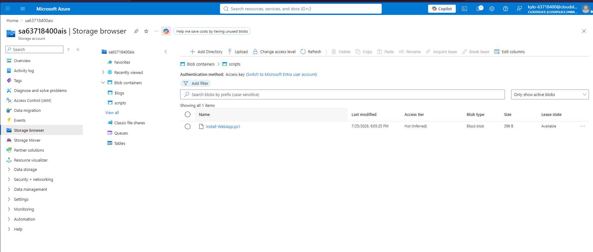  

**Next, the Custom Script Extension was selected from the extension gallery and linked directly to the configuration script:**  

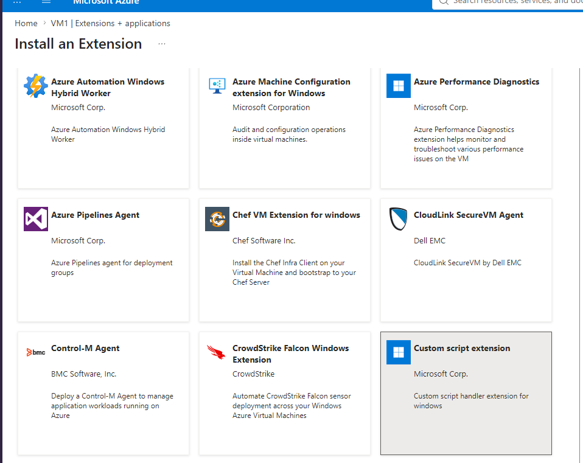  

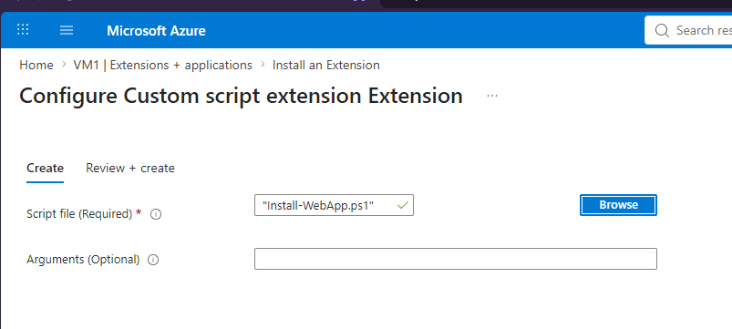  

**Once applied, the extension executed the script in the background and reported a successful provisioning state:**  

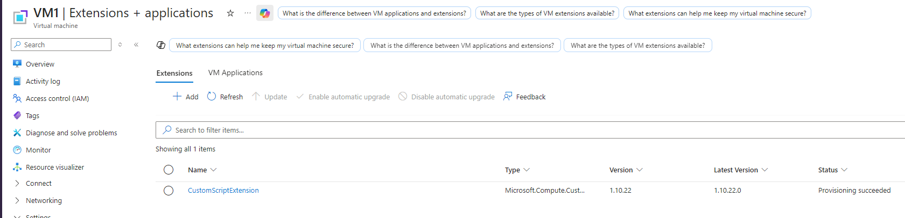  

**Finally, browsing to the server's public IP confirmed that the web service was installed and running as expected:**  

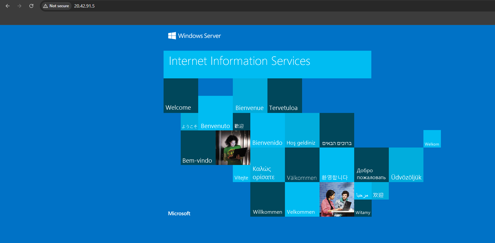  

**Key Takeaway:** manually using RDP to get into VMs and implement IIS is prone to errors and doesn't scale. Custom Script Extensions solve this at the infrastructure layer. New VMs automatically self-configure during provisioning. This is helpful for reducing repetition and building systems that scale.

### Lab 4: Protect Workloads, Azure Backup and SQL Workload Protection  

**Objective:** Implement enterprise data protection and disaster recovery policies using a Recovery Services Vault to safeguard both Azure Virtual Machines and internal SQL Server database workloads.  

**Technical Implementation:** Initialized a user database on an Azure-hosted SQL Server, configured automated VM snapshot retention schedules, triggered workload discovery via the Recovery Services Vault, and applied transaction log backup policies across database instances.  

**First, a target database was initialized within SQL Server Management Studio to serve as the application workload:**  

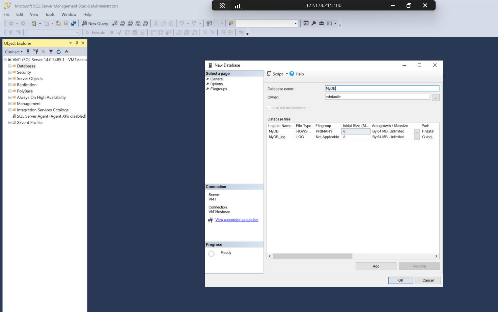  

**Next, a custom recovery policy was created inside the Recovery Services Vault to govern daily snapshot frequencies and operational retention:**  

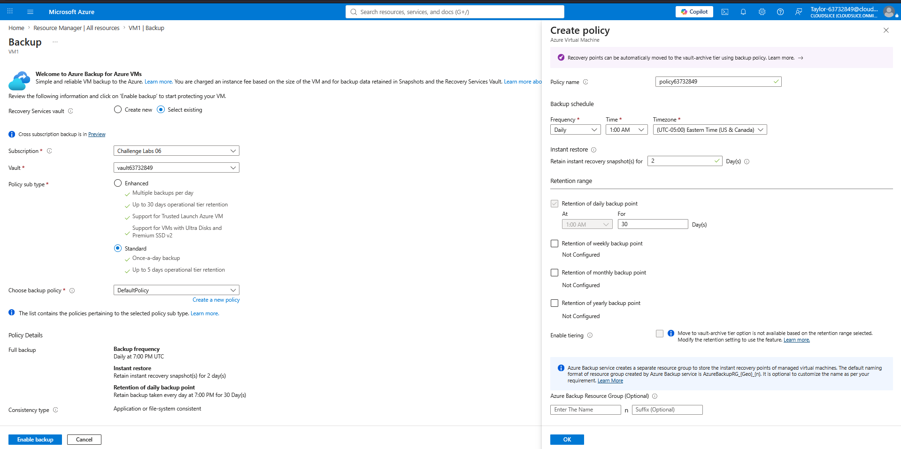  

**To extend protection directly to the database tier, the Recovery Services Vault initiated workload discovery across the SQL Server instance:**  

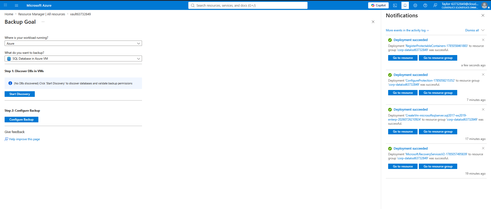  

**Finally, transactional log policies were mapped to the discovered databases to ensure point-in-time recovery capabilities:**  

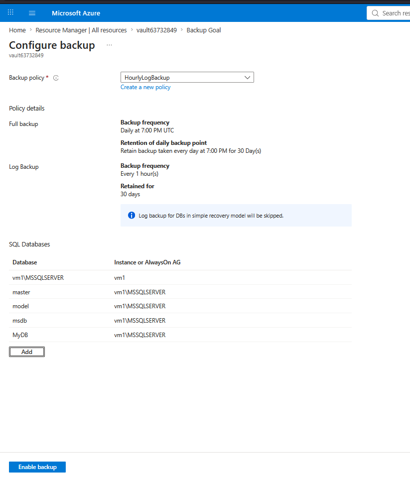  

**Key Takeaway:** Azure Backup provides centralized business continuity management for infrastructure and database workloads alike. Combining VM-level image snapshots with application-aware SQL log backups ensures rapid recovery options for both complete virtual machine failures and granular database corruption events.