# provisioning-automation-and-monitoring
## Project Focus
This repository documents practical infrastructure automation, performance monitoring, centralized logging, and PaaS deployment across Microsoft Azure. The core objective was building system reliability and efficency: automating VM provisioning across multiple interfaces, establishing real-time alerting for on-call readiness, centralizing logs for rapid troubleshooting, and enabling full-stack observations for application workloads. These labs capture the day-to-day work of running production infrastructure deployment consistency, incident alerting, and drilling down into failures when they occur.


## Lab Module Breakdowns
### Lab 1: Automated Infrastructure Provisioning via ARM Templates, Azure PowerShell, and Azure CLI
**Objective:** Deploy identical Windows VMs using three different automation methods (ARM template via Portal, PowerShell script, Azure CLI), each with its own syntax rules. The goal is to understand why sysadmins need to be well acquainted across systems and how to debug when tools conflict with each other.

**Technical Implementation:** Configured ARM templates to comply with Azure Policy naming constraints, fixed PowerShell array syntax errors, debugged Azure CLI argument case sensitivity, and validated all three deployments achieved identical end states.


**To automate deployment via IaC, an ARM template was imported into the portal. However, initial validation failed due to an enterprise governance policy restricting default resource names:**
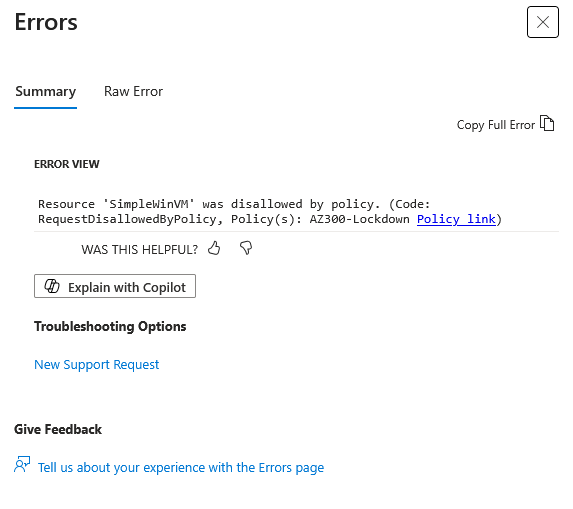

**Enterprise environments enforce Azure Policies for many reasons, in this case its in the hopes of ensuring intentional standardized resource naming.**  
**To follow best practice I created a vmName parameter within the JSON template schema. This allowed for greater control over the naming conventions during deployment setup:**  

```json
"variables": {
    "vmName": "[parameters('vmName')]"
}
```  

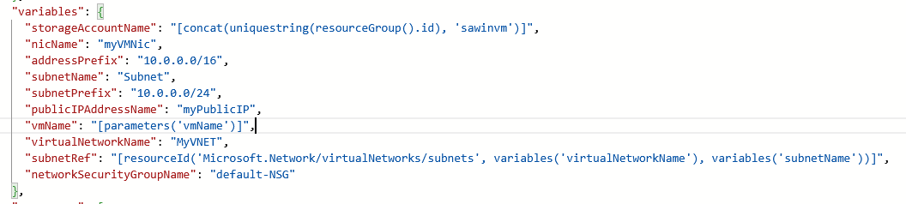

**For provisioning the second host via Cloud Shell, an Azure PowerShell script was executed using New-AzVM. The initial command failed during parameter parsing:**

```shell
# Error encountered:
# New-AzVM: Cannot bind parameter 'OpenPorts'. Cannot convert value "[80]" to type "System.Int32".
```  
**Unlike the notation commonly seen in programming languages, Powershell does not recognise square brackets for arrays.**  
**Instead it enables arrays to be created through a comma separated list format, which I was able to pick up and learned here:**  

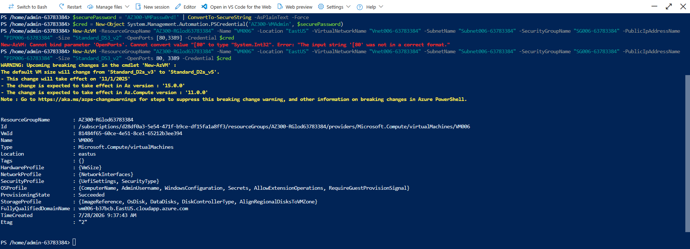  

**The final host was deployed using the Azure CLI bash environment. Initial execution threw an unrecognized arguments error due to the incorrect casing on the location flag (--Location EastUS):**

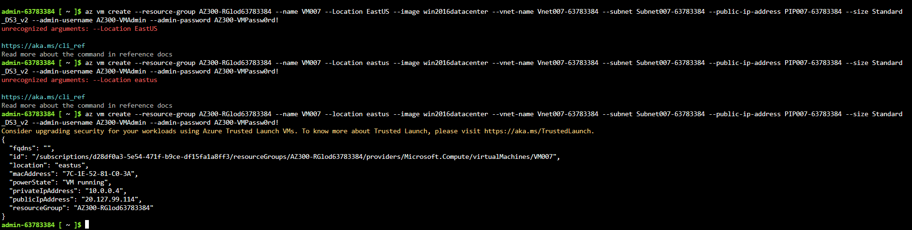  

**While it took a couple tries, I was able to figure out that unlike Powershell, the Azure CLI strictly expects lowercase letters when entering argument flags**

**Once all three deployment pipelines completed, the resource group was audited to confirm uniform configuration and provisioning health across all Virtual Machines:**  
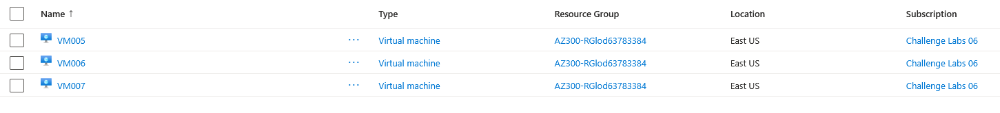  

**Key Takeaway:** Infrastructure provisioning isn't one-size-fits-all. Mastering ARM templates, PowerShell, and Azure CLI provides deployment flexibility, but each interface requires specific syntax and an understanding of underlying Azure Policy constraints to ensure automation occurs smoothly.  

### Lab 2: Performance Monitoring and Automated Metric Alerting  

**Objective:** Provision a Linux host via Azure CLI, configure real-time performance tracking in Azure Monitor, establish threshold-based alert rules with automated email notification channels, and validate the full incident lifecycle (activation to resolution) using a synthetic CPU stress workload.  

**Technical Implementation:** Deployed an Ubuntu 22.04 VM with CLI SSH key generation, bound a metric alert rule to CPU utilization, routed alerts through a dedicated Action Group, and validated automated email triggering and auto-resolution under a synthetic stress load.  

**To establish the target workload, an Ubuntu 22.04 host was deployed via Azure CLI in Cloud Shell, auto-generating SSH key pairs during initialization:**
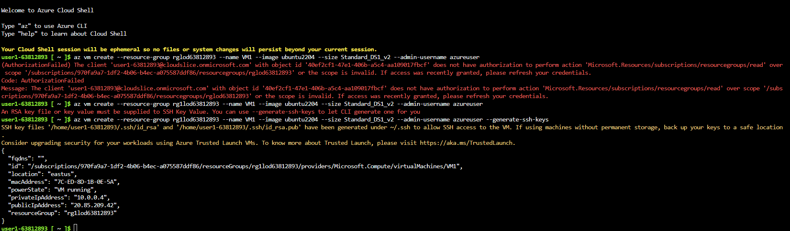  

**An Action Group named Cloud Operations was defined to act as the central notification router. An Azure Monitor metric alert rule was then attached to VM1 targeting Percentage CPU, evaluating average utilization every 1 minute against a 85% threshold:**  

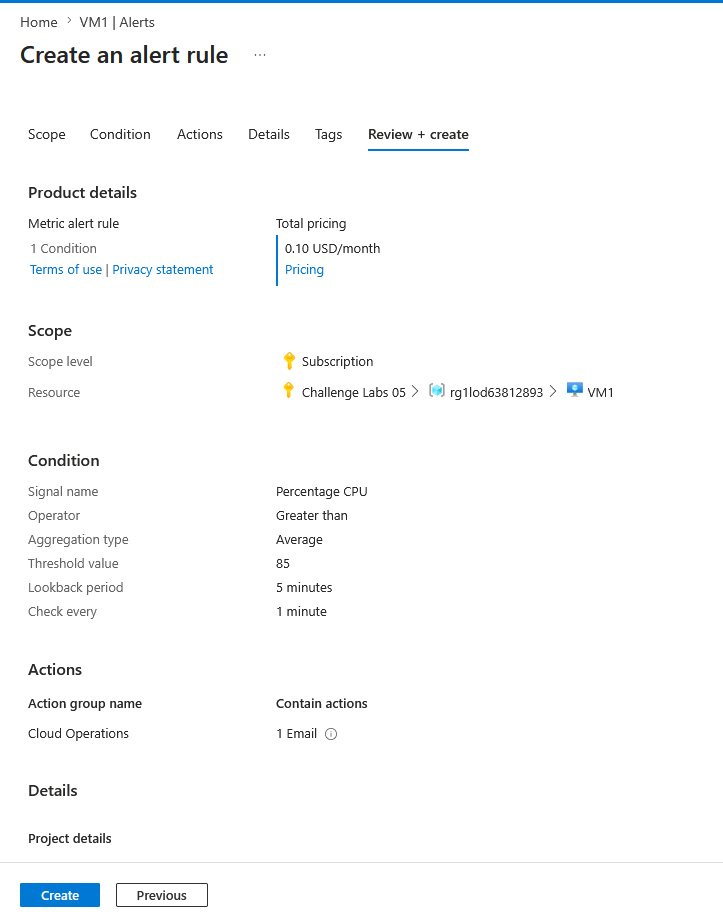  


**To test the alert pipeline under real conditions, SSH access was established on VM1, and the Linux stress utility was launched to simulate resource exhaustion:**  

```bash
# Install benchmark tool
sudo apt-get install stress -y

# Launch 8 worker threads for 480 seconds in the background
sudo stress --cpu 8 --timeout 480 &
```  

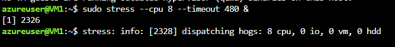  

**Azure Monitor ingested the sudden spike, recording CPU saturation at 87.09%, crossing the threshold and firing the alert rule:**

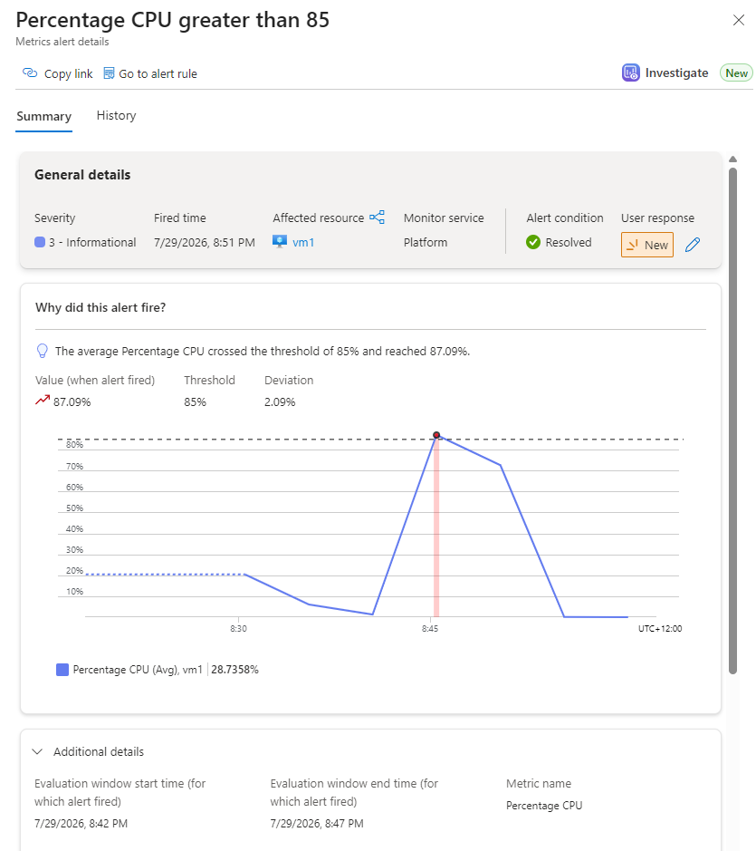  

**Simultaneously, Azure dispatches an automated alert email directly to the operational team inbox:**  

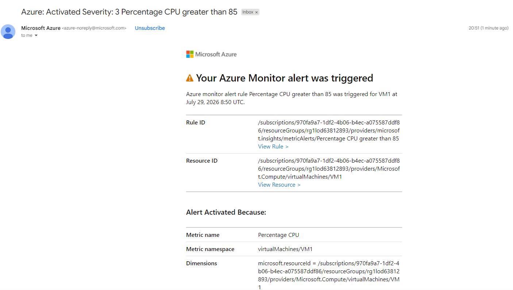  

**While Azure Monitor metrics can update in near-real-time, the alert evaluation windows needed to detect anomalies mean notifications do not trigger instantaneously. Experiencing this delay firsthand highlights how significant of an impact it could make into SLA and incident handling targets and why it needs to be taken into account ahead of time.**  

**Following the 480-second stress timeout, CPU utilization returned to baseline (~10%). Azure Monitor evaluated the recovery during its next check interval, marked the alert as Resolved, and dispatched a deactivation notice:**  

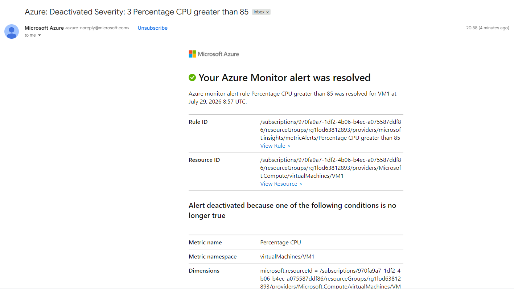  

**Key Takeaway:** Demonstrating a complete alert lifecycle, from a synthetic trigger through to notification delivery and automated recovery, proves that monitoring infrastructure is integral by providing both timely incident warnings as well as greatly freeing up human resources with surveillance automation.  

### Lab 3: Centralized Log Analytics, Data Collection Rules, and KQL Querying  

**Objective:** Provision an Azure Log Analytics Workspace, configure granular Data Collection Rules via the Azure Monitor Agent framework to capture system information, and execute target KQL queries to perform health checks and metric extraction across onboarded endpoints  

**Technical Implementation:** Deployed a Log Analytics Workspace, defined a Data Collection Rule targeting Windows Event Logs and Performance Counters, and validated log ingestion, agent versioning, and host memory counters via KQL queries.  

**To collect system logs across virtual machine workloads, a Log Analytics Workspace was deployed under a Pay-as-you-go billing model:**

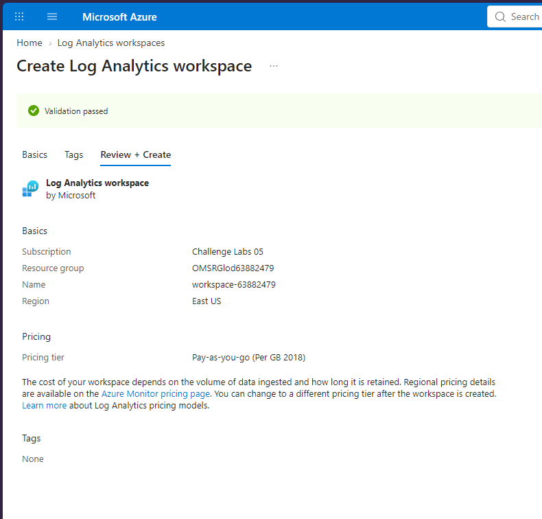  

**Using the Azure Monitor Agent, a Data Collection Rule was created to explicitly define sources and target destinations:**

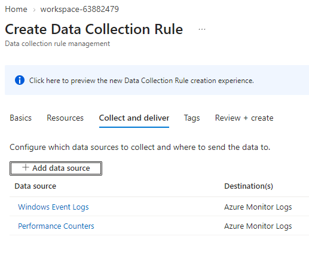  

**The DCR was then bound directly to the target virtual machine resource:**  

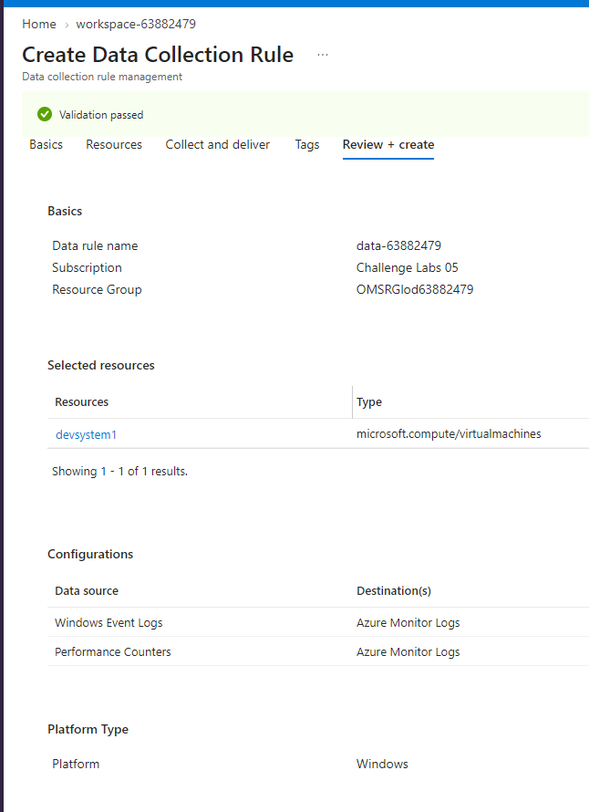  

**KQL queries were then executed within the workspace to audit endpoint health and verify metric ingestion.**  

**By using the following query against the Heartbeat table, I was able confirmed active connection status and highlighted the running Azure Monitor Agent version:**  
```kql
Heartbeat
| summarize arg_max(TimeGenerated, *) by Computer
| project Computer, Version
```  

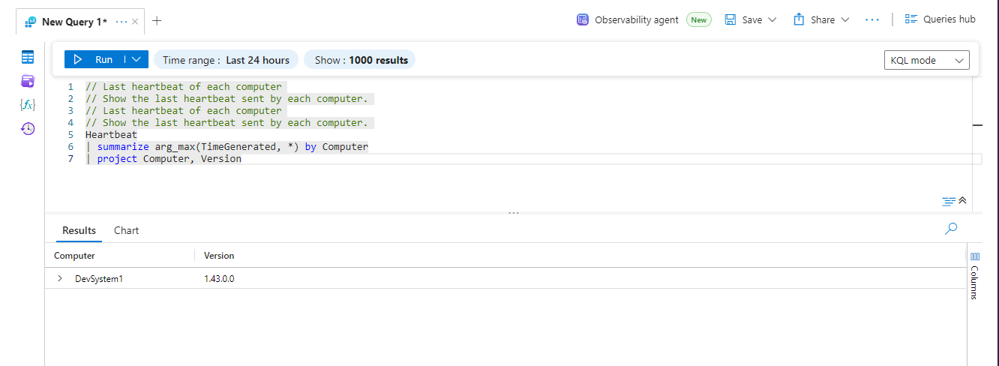  

**Executing a query against the Perf table host memory data demonstrated to me that performance metrics could be collected by the Azure Monitor Agent with a high level of precision:**  


```kql
Perf
| where ObjectName == "Memory" and CounterName == "Available Bytes"
| project Computer, CounterValue
| take 1
```  

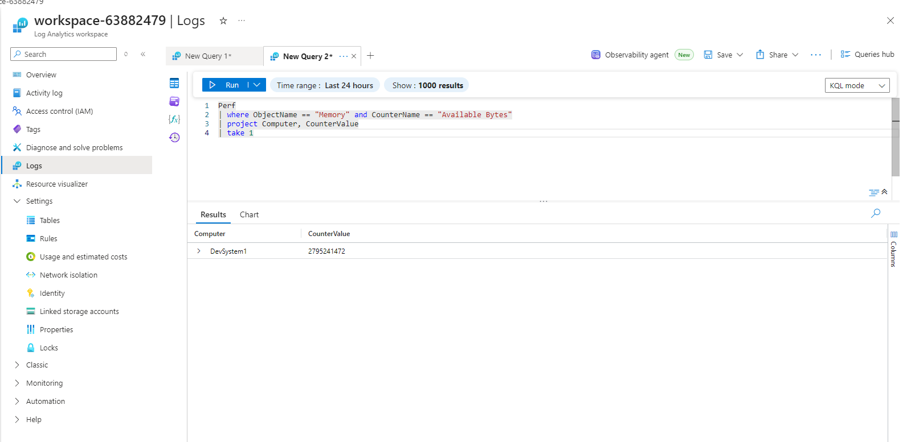  

**Key Takeaway:** Using the Azure Monitor Agent and Data Collection Rules allows for you to target specific data across a virtual instances without requiring the user to search through verbose tables of information.

### Lab 4: Azure App Service Deployment, Continuous Integration, APM, and Web Server Diagnostics

**Objective:** This lab focuses on provisioning a dedicated Windows-based Azure App Service instance, establishing continuous integration/deployment (CI/CD) via External Git, instrumenting Application Performance Monitoring with Azure Application Insights, and resolving diagnostic visibility challenges using native App Service Web Server logging streams.  

**Technical Implementation:** Deployed a Windows-based App Service instance on a Basic App Service Plan, linked an External GitHub repository in Deployment Center, configured Application Insights tied to a Log Analytics Workspace, and resolved stream diagnostic visibility issues by switching from Application logs to Web Server logs.  

**To establish the web hosting infrastructure, an App Service instance was provisioned under a Basic App Service Plan to support dedicated compute resources and diagnostic log features:**

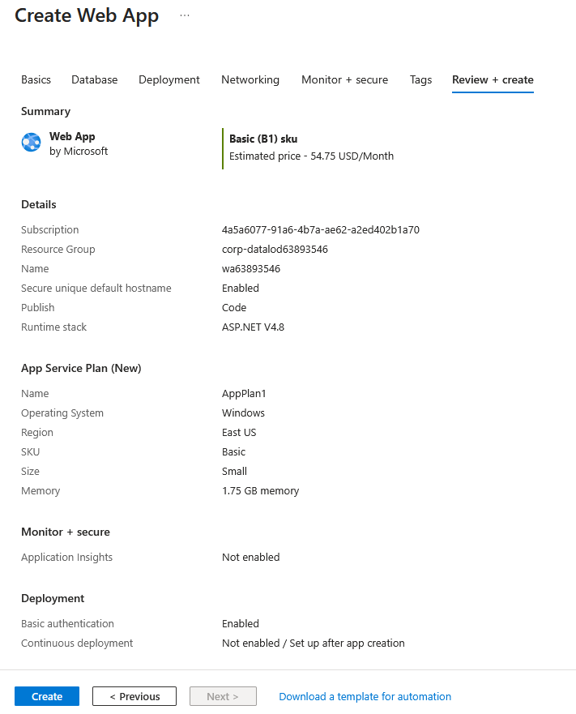  

**Before pushing code, the default Azure App Service landing page was accessed over HTTPS to verify host provisioning and web server readiness:**  

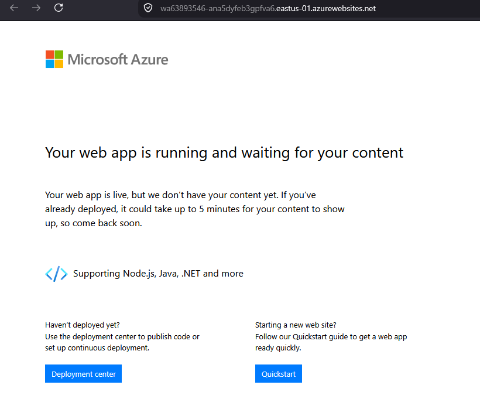  

**Continuous deployment was then configured in Deployment Center by connecting an external Git repository containing the ASP.NET web application source code:**  

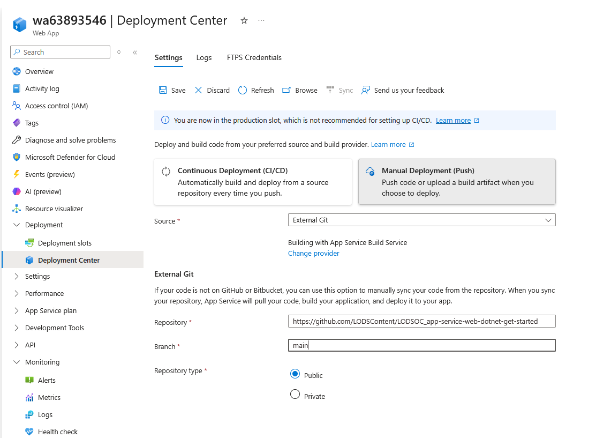  

**During initial build deployment and worker process cold-start, accessing the endpoint temporarily returned a service availability response while assemblies compiled:**  


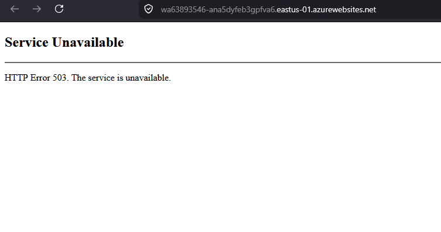  

**Once the process completed initialization, refreshing the URL successfully rendered the live ASP.NET web application:**  


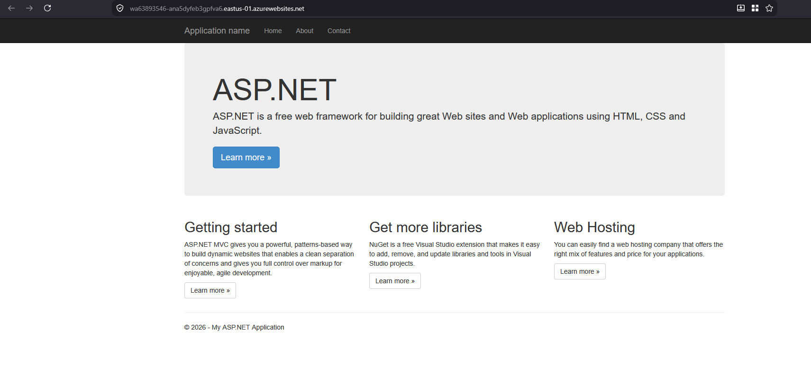  

**To enable end-to-end observations, Application Insights was enabled and linked to an existing Log Analytics Workspace:**  


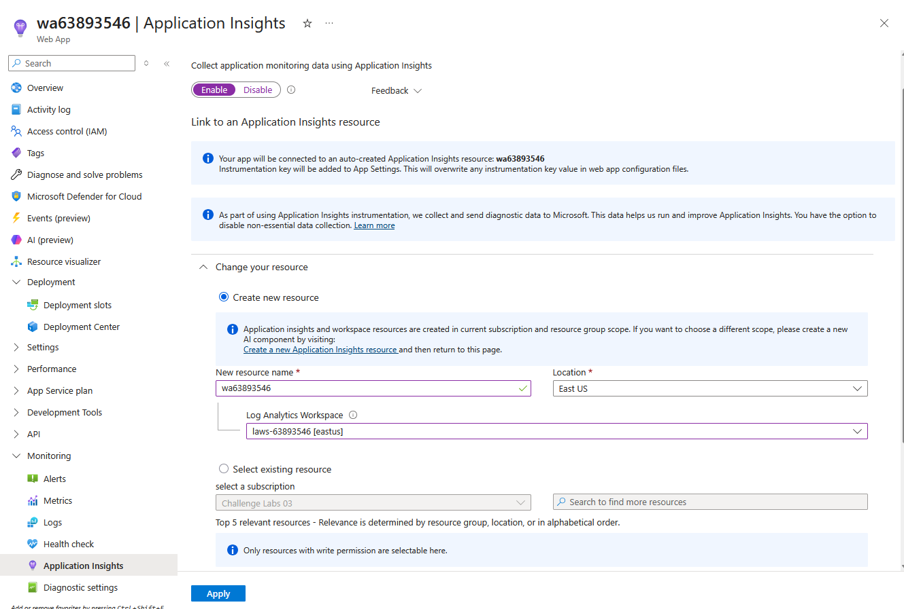  

**Simulating active user traffic allowed for real-time tracking in Live Metrics, capturing server response times, incoming requests, and active process execution:**  

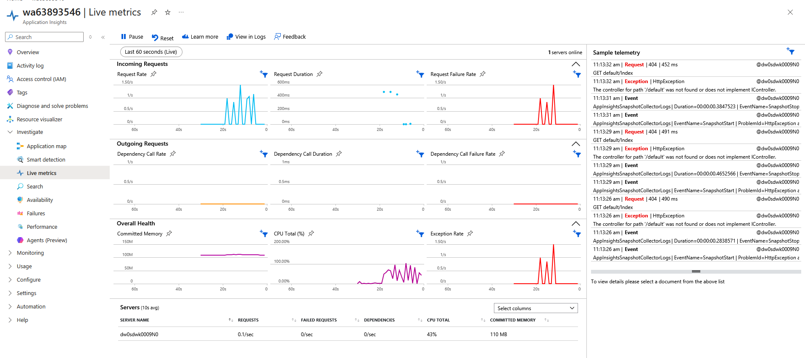  

**Navigating to non-existent endpoints generated unhandled route exceptions, which were aggregated and categorized within the Failures dashboard:**  

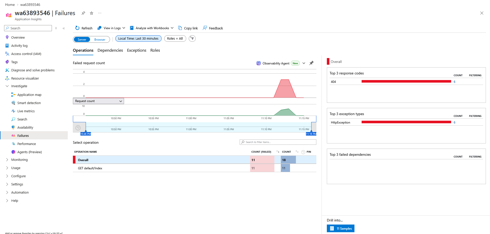  

**To capture low-level HTTP status traces directly from the server host, Web Server Logging (Filesystem) and Detailed Error Messages were explicitly enabled in App Service Logs:**  

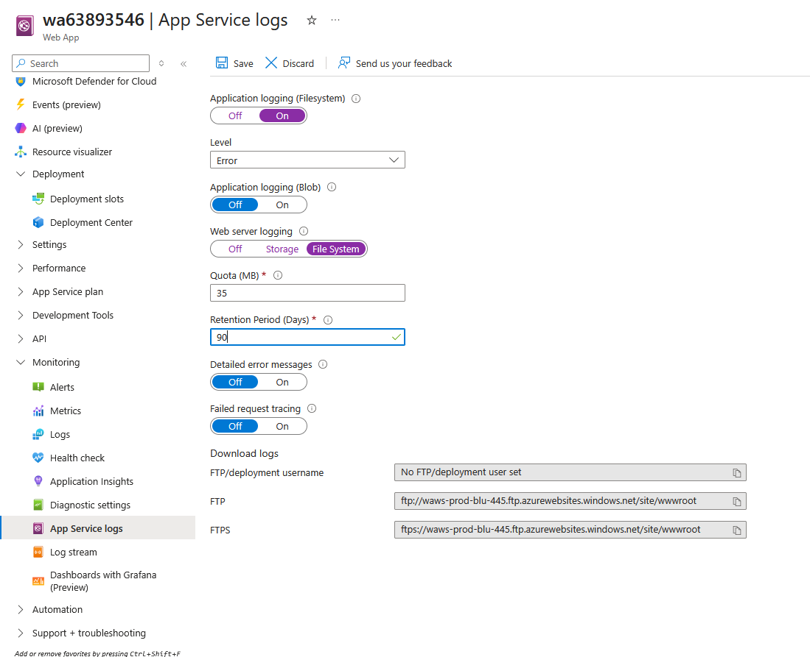  

**When trying to trace these HTTP 404 route errors live in the Log stream console, selecting Application logs resulted in a completely empty stream despite continuous traffic:**  

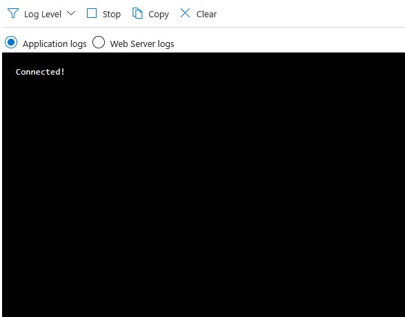  

**Realizing that unhandled 404 route errors are caught by the IIS web server before reaching custom application code taught me that they won't emit standard application traces. Toggling the log stream filter over to Web Server logs instantly exposed the raw, live HTTP access requests, status codes, and routing headers:**  

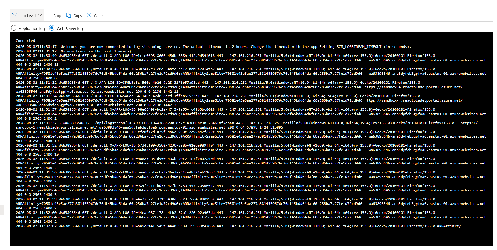  

**Key Takeaway:** Combining Application Insights for code performance with App Service Web Server logging provides full-stack visibility, ensuring developers don't miss host-level routing errors that occur before application code ever runs.


